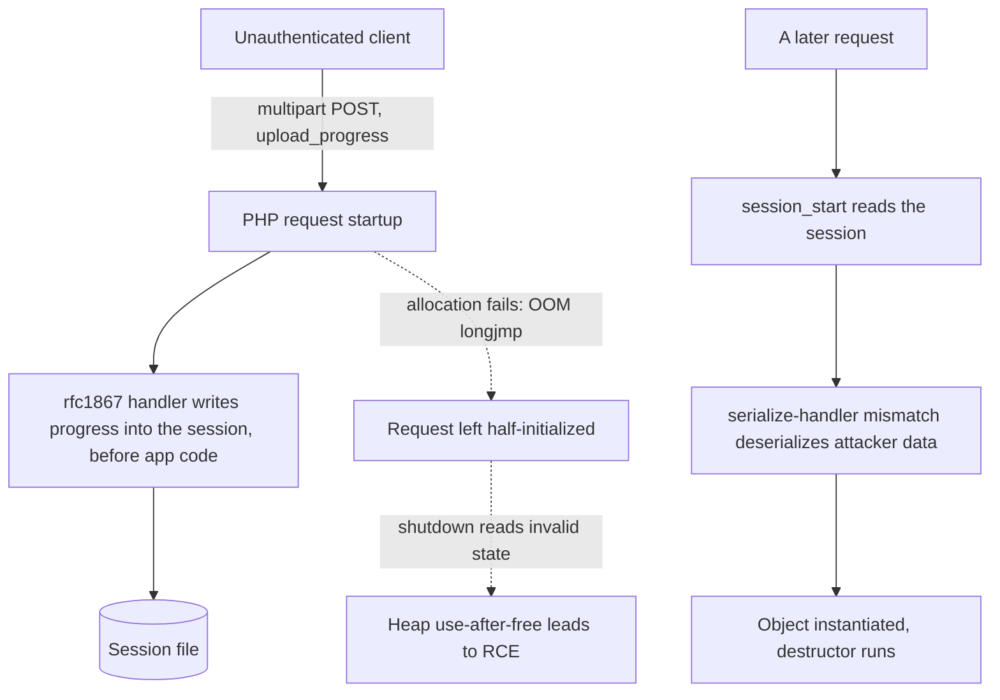
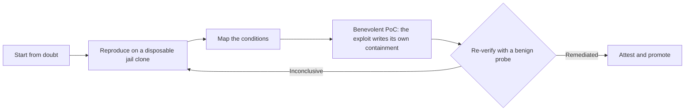

# php2shell-remediate

**Is your PHP exposed to CVE-2026-109618 / CVE-2026-109619 ("php2shell"), and
did your fix actually hold?** This tool answers both — and ships a benevolent
proof-of-concept that lets you *test a server by securing it*, before a vendor
patch is even applied.

The classifier is a small, dependency-light Rust program with a pure decision
core — no network, no process execution, no payload. The repository also ships a
benevolent proof-of-concept that demonstrates the flaw by **closing** it.

> **Read the whitepaper:**
> [*php2shell, and the benevolent exploit: testing a server by securing it*](docs/php2shell-whitepaper.md)
> — the full method, history, benevolent PoC, and disclosure ethics.
> (All Rights Reserved; not under the code license.)

---

## Need this handled? Hire the author.

**Nestor Wheelock — South City Computer** takes on CVE-2026-109618 /
CVE-2026-109619 remediation commercially and professionally: estate assessment,
patching, sandbox-first verification, and attestation that the flaw is genuinely
closed — not assumed closed from a version number.

- **Get in touch:** [southcitycomputer.com](https://southcitycomputer.com) ·
  [@nestorwheelock on GitHub](https://github.com/nestorwheelock)
- Engagements: one-off remediation, estate-wide rollout, retained advisory, or a
  second opinion on an in-progress response.

---

## This will keep happening — which is the point

php2shell is **not a new problem discovered by some super-intelligent tool.** It
is a recombination of behavior PHP's own bug tracker and CVE record have
described since **2008** (see [Background](docs/BACKGROUND.md)): a decade-old
`session.upload_progress` delivery path and an even older `zend_bailout`
state-corruption hazard, combined into a pre-authentication remote code
execution. Anyone with the public fix commit and the history could reconstruct
it. It took patience and a lab, not magic.

It was also human-led. The AI assistant used along the way refused the offensive
specifics on safety grounds and had to be steered at every step; the hypotheses,
the lab, the reproduction, and the verification were the author's. A person
figured this out — the automation helped with scaffolding and write-up, not with
the reasoning.

And it will not be the last. A memory-unsafe engine executing untrusted input
guarantees more of the same. That is exactly why this tool is written in
**Rust**: a program that tells you whether you are exposed, and whether your fix
held, must not itself carry the class of defect it checks for. This classifier
*cannot* have the use-after-free it reports on. The useful question for a PHP
estate is not "are we clear of this one bug" but "who keeps us ahead of the next
one." See the [epilogue](docs/BACKGROUND.md#epilogue--this-will-keep-happening-and-why-that-argues-for-rust).

---

## How the flaw works

An unauthenticated request plants attacker-controlled data in a PHP session
before application code runs; a later request deserializes it. Separately, an
out-of-memory condition during request parsing makes the engine bail out of a
half-initialized state that shutdown then reads as freed memory.



## The approach: test by securing, then verify

The method is deliberately repeatable: start from doubt, reproduce the live flaw
on a disposable clone, then remediate and **re-verify** — never trust a version
string alone. The included benevolent proof-of-concept is at once the test (it
only reaches the destructor if the flaw is live) and a mitigation (it leaves the
vulnerable feature disabled).



Full write-up: [docs/METHODOLOGY.md](docs/METHODOLOGY.md). The benevolent
proof-of-concept and its guardrails: [examples/benevolent-poc/](examples/benevolent-poc/).

## Fixed versions

| Branch | Fixed in |
|--------|----------|
| 8.5    | 8.5.12   |
| 8.4    | 8.4.27   |
| 8.3    | 8.3.36   |
| 8.2    | 8.2.35   |

7.4 / 8.0 / 8.1 are end-of-life and receive no official vendor fix; the tool
reports those separately rather than inventing a fixed version, and the only
remedy there is migrating to a supported branch. A branch the advisory does not name is reported as
`UNKNOWN-BRANCH`, never guessed into patched or exposed.

## Usage

```
php2shell-remediate classify <php-version-string>
```

Accepts a bare `8.2.35`, an `X-Powered-By` value like `PHP/8.2.35`, or a distro
build string (`8.1.29-1+deb.sury.org+1`). Exit codes: `0` patched · `1` exposed,
EOL, or unknown-branch · `2` bad input.

```
$ php2shell-remediate classify PHP/8.4.26
EXPOSED 8.4.26 — fixed in 8.4.27
$ php2shell-remediate classify 8.4.27
PATCHED 8.4.27
```

## Library

The crate exposes the decision functions for embedding: `parse_php_version`,
`classify_exposure`, `plan_remediation` (handles the real case where a package
branch lags the fix — e.g. FreeBSD `quarterly` behind `latest`), and
`interpret_probe` (benign re-verification; a session the handler never read is
`Inconclusive`, never reported as remediated).

## Build and downloads

```
cargo build --release
cargo test
```

Prebuilt binaries are published on the releases page: a Windows `.exe`, a
statically linked Linux binary (`x86_64-unknown-linux-musl`), and a FreeBSD
package (`FreeBSD:15:amd64`). Each release ships `SHA256SUMS` — verify before
running.

## Background and references

The full history, the regression analysis, and every source are in
[docs/BACKGROUND.md](docs/BACKGROUND.md). Key references:

- Advisory analysis: [Mend — CVE-2026-109618](https://www.mend.io/vulnerability-database/CVE-2026-109618/) ·
  [CrowdStrike — PHP2Shell](https://crowdstrike.com/en-us/blog/crowdstrike-protects-customers-from-php-rce-zero-days) ·
  [Amazon Linux ALAS](https://explore.alas.aws.amazon.com/CVE-2026-109618.html)
- Lineage: [PHP bug #46025 (2008, bailout)](https://bugs.php.net/bug.php?id=46025) ·
  [bug #71101 (2015, upload_progress)](https://bugs.php.net/bug.php?id=71101) ·
  [bug #72681 / CVE-2016-7125](https://bugs.php.net/72681) ·
  [Exploit-DB 50156 (2021)](https://exploit-db.com/exploits/50156)
- Memory safety: [White House ONCD, "Back to the Building Blocks"](https://bidenwhitehouse.archives.gov/oncd/briefing-room/2024/02/26/press-release-technical-report) ·
  [CISA, "The Case for Memory Safe Roadmaps" (PDF)](https://media.defense.gov/2023/Dec/06/2003352724/-1/-1/0/THE-CASE-FOR-MEMORY-SAFE-ROADMAPS-TLP-CLEAR.PDF)

## License

Code: BSD-2-Clause. See [LICENSE](LICENSE). Accompanying written articles and
research prose are **All Rights Reserved** and not covered by the code license.
