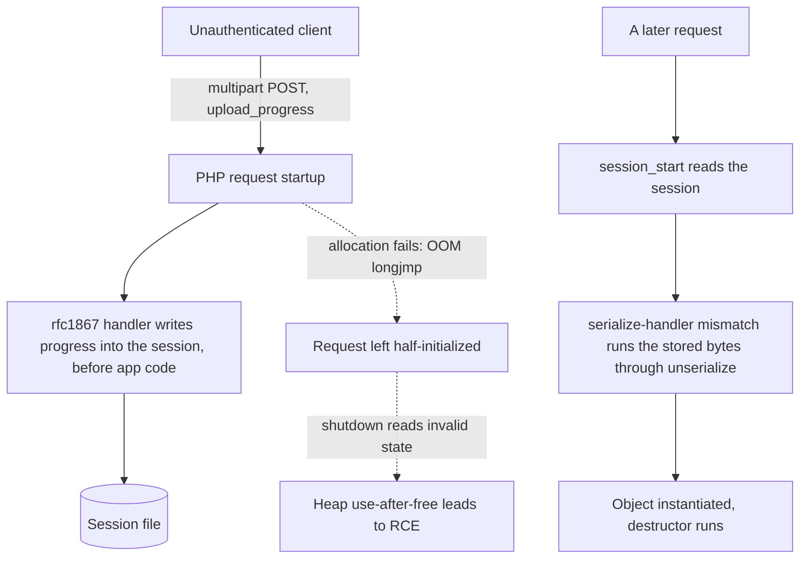
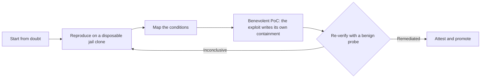

<!--
  All Rights Reserved. (c) 2026 Nestor Wheelock / South City Computer.
  This written work is NOT under the repository's BSD-2 code license. It is
  published alongside the code as accompanying research prose; all rights reserved.
-->

# php2shell, and the benevolent exploit: testing a server by securing it

**Nestor Wheelock — South City Computer**
Draft · All Rights Reserved

## Abstract

In October 2026 the PHP project shipped fixes for CVE-2026-109618 and
CVE-2026-109619 — the pair the industry labelled "php2shell": an unauthenticated,
pre-application-code path to remote code execution in one of the most widely
deployed runtimes on the web. This is not a disclosure of that bug, which is
public and, as the history shows, was never really new. I offer three things a
defender can use: a repeatable method for proving whether a server is exposed and
whether a fix held, built on reproduction rather than a version string; a
benevolent proof-of-concept that inverts the exploit, so the same reachable path
that would run a payload instead secures the server; and an argument that
withholding the detail needed to verify a fix taxes defenders more than attackers,
who reconstruct it from the public patch anyway. One thread runs underneath: the
reconstruction was done by a person. The automated assistant refused the security
specifics, needed direction at every turn, and offered to give up — evidence
against the story we are told about where this technology already is.

## 1. The two edges

Memory-unsafe runtimes produce memory-safety bugs on a schedule; the bug itself is
the least interesting part of this work. What matters sits at the edges: the
reconstruction — rebuilding how the flaw operates from nothing but the public fix
and the historical record, because the exploitation detail was withheld — and the
ethics, because once you can reproduce a flaw you can remediate it through the same
path, which raises an old question: when is it right to fix a system you were not
asked to touch?

## 2. The flaw

php2shell has two halves. The delivery half abuses PHP's session upload-progress
feature. With `session.upload_progress.enabled` on — a default — a multipart
request carries a field named by `session.upload_progress.name`, and PHP writes
progress data into the session under a storage name the request controls, before
any application code runs. If a later request decodes that data under a different
`session.serialize_handler` than wrote it, the stored bytes run back through
`unserialize()`, and an attacker's serialized object is instantiated — and its
destructor executed — on the server.

The state-corruption half is deeper. On a failed allocation PHP ends the request
with `zend_bailout()`, a `longjmp` that unwinds the C stack without normal cleanup.
If it fires while request memory is reachable but half-initialized, request
shutdown later reads freed or stale heap. CrowdStrike points at
`_zend_hash_str_add_or_update_i()` in `Zend/zend_hash.c`, which takes a pointer to
a new bucket before allocating the copy of the name, so a failed allocation leaves
the bucket pointing at stale memory. An unauthenticated attacker drives the
allocator to failure through ordinary multipart parsing, so the corruption is
reachable before application code on Apache's mod_php, and on FPM.

The two CVE numbers cover distinct failure modes, and the public write-ups do not
agree on which number is which. Sansec assigns the upload-progress path to
CVE-2026-109618 and a fatal-error-backtrace use-after-free, with an OPcache type
confusion, to CVE-2026-109619; Ellio instead places the upload-progress path under
CVE-2026-109619, tied to advisory GHSA-6wmf-4rv5-p3rp as "RCE via stale global
state." Both carry a CVSS v4.0 score of 9.2, both were under active exploitation
before the fix shipped — reportedly from 17 October, four days early — and in every
account the only complete remedy is to upgrade. I describe the mechanisms by
behavior rather than by number here, and defer the numbering to PHP's own advisory.

The fixed releases are PHP 8.2.35, 8.3.36, 8.4.27, and 8.5.12; end-of-life
branches (8.1 and older) receive no official vendor fix. The mechanism detail above
comes from third-party sources — Mend, CrowdStrike, Amazon Linux ALAS — not an
official PHP advisory, and should be confirmed against the upstream fix commit.

## 3. History: not new, and not an AI discovery

The delivery half is a decade old. In 2015, PHP bug #71101 described how, with
upload-progress enabled, an attacker chooses the storage name under which progress
data lands in the session, after which it passes through whatever serialize handler
is configured. In 2016, bug #72681 — CVE-2016-7125 — confirmed the session
deserializer let user input reach `unserialize()`, injecting objects and not merely
strings (fixed in PHP 5.6.25 and 7.0.10), alongside related fixes CVE-2016-7124,
CVE-2015-6835, and CVE-2015-4602. Yet in 2021, Exploit-DB 50156 chained the
upload-progress path into code execution on PHP 7.3.15: patched for one abuse, it
stayed a usable delivery path for years.

The state-corruption half is older. In 2008, PHP bug #46025 reported a
`zend_bailout` during `HANDLE_BLOCK_INTERRUPTIONS` corrupting APC's shared memory
and deadlocking its mutex; the reporter proposed deferring the jump. Bug #59281 was
closed "won't fix," holding that the remedy belonged in APC, not the engine. Bug
#16820 recorded a timeout jump that skipped a lock release and hung the process.
The shape — bail out of an unsafe point, leave state wrong — was documented
repeatedly and treated as somebody else's problem.

So this is not a regression of a prior fix. It is two long-known hazards — one
never comprehensively fixed, one fixed only for a narrow case — recombined in 2026
into a single pre-authentication remote code execution. The 2026 fix is broad, not
narrow: the public fix commit adds a general out-of-memory state path to the Zend
engine — a new `ZEND_HAS_OOM` check, fallible allocators, and a deferred-bailout
handler — together with dozens of new out-of-memory regression tests, rather than a
patch to one call site. On this reading it is the first general engine-level fix of
a hazard flagged as far back as 2008; confirming that no earlier partial fix was
undone would still require bisecting the upstream history. It was not conjured by a
super-intelligent tool. Anyone holding the public fix commit and willing to read
fifteen years of bug history could reconstruct it — with patience and a lab.

## 4. Method: doubt, reproduce, remediate, re-verify

Start from doubt. An advisory says a flaw exists; it does not say whether your
configuration is exposed. So the first question, asked of the flaw and again of the
fix, is: is it even true here? Answering means two reproductions — reproduce the
exposed behavior on a known-vulnerable build so you know the signal of a live flaw,
then run the same test against the patched build so the fix is confirmed by the
signal's disappearance, not a version number.

The lab is disposable: the vulnerable host is a FreeBSD jail made by a ZFS snapshot
of a template dataset followed by a clone — a copy-on-write fork driven into a
broken state and then discarded. Nothing inside reaches the template or another
host, and nothing faces the internet; every change is backed up before the edit and
restored after. Two rules keep results honest: every test runs with a positive
control — the expected-failure case beside the expected-success case — and with
error output visible. A result that cannot be reproduced alongside its control is
unproven, not a finding.

## 5. The benevolent proof-of-concept: test by securing

Here is the inversion at the center of this work. The same reachable path that
would carry a harmful payload can carry a remediation instead. In the demonstration
the object delivered through the deserialization path has a destructor that does
one thing: it writes a per-directory `.user.ini` that disables the vulnerable
upload-progress feature. The exploit closes the door it came through.

So the demonstration is at once the test and the mitigation. It reaches the
destructor only if the flaw is live, so a result is proof of exposure, and it
leaves the feature disabled — a check an operator can run before a vendor patch
exists, carrying nothing whose default behavior is harm. The proof-of-concept is
deliberately constrained: its only action is the one configuration line, and it
acts only when the operator has placed an explicit authorization sentinel file in
the target directory — an environment-independent gate chosen after a
loopback-address check proved brittle, since inside a jail or behind a proxy the
local address is not what you expect. It has been reproduced on FreeBSD 15 / PHP
8.4: before the run the target carried only its serialize-handler line; after, the
containment line as well, written through the deserialization path. It ships under
a permissive license, because the mechanism is already public and what a defender
needs is a safe worked example.

## 6. The reconstruction was human-led

The investigative method was mine: where to pursue and when to double back; reading
the vendor fix commit as a specification of what had been unsafe; mining PHP's own
bug tracker for the decade of prior reports. Those moves solved it, and none were
the typing. The automated assistant refused the offensive specifics on safety
grounds, and when it was constrained the usable model changed underneath the
session. More than once it proposed abandoning a line after a few failed attempts —
in effect, "I tried three things, I give up." Each was carried through on my
insistence. The automation was useful for scaffolding, code, and the write-up; it
did not do the figuring-out, and left to itself it would have stopped.

The prevailing story about this technology is of autonomous, super-intelligent
systems that find and exploit everything and slip human control. This episode is a
small counterweight. The model balked at the security content, needed step-by-step
direction, and offered to quit when a handful of attempts failed. A capable human
drove; the tool assisted. Whatever is coming, we are not there yet.

## 7. Disclosure: benevolence, consent, and asymmetry

Publishing rests on an old argument. The full-disclosure tradition — Bugtraq, Rain
Forest Puppy's disclosure policy — turns on an asymmetry: embargoed exploitation
detail reaches capable attackers anyway, because the public patch is itself a
specification of the bug, while the defenders who need that detail to verify their
own remediation are left without it. Withholding mostly taxes defense. php2shell is
a clean example: the mechanism is derivable from the fix commit and the fixed
versions are already propagating, so a self-limiting proof-of-concept adds little to
an attacker's reach while giving defenders a way to check their systems.

That framing invites a harder question. In 2018 a grey-hat going by Alexey said he
had accessed on the order of a hundred thousand MikroTik routers through a known
flaw, CVE-2018-14847 — a self-reported figure — clearing other attackers' malware,
applying the patch, adding firewall rules, and leaving notes for some
administrators; commentators called the methods unlawful even as they called the
aim protective. It sits in a lineage with "benevolent" malware like Linux.Wifatch
(the self-styled "White Team," 2015) and the Hajime botnet (2016–2017), which
hardened devices their authors had no permission to touch. I have been on
the receiving end: a stranger once secured a device of mine without asking, and I
was grateful. Hack me, please, if you are saving me from something worse — yes,
thank you. That gratitude reframes the question from "was it authorized" to "what
did the owner want."

Both truths hold at once. What is right is not necessarily legal. Reaching into a
system you do not own — even to fix it — is unauthorized access, and it can be
prosecuted whatever the intent; benevolence is not a legal defense, and this paper
will not pretend otherwise. The proof-of-concept here is a laboratory instrument for
testing your own systems, gated behind an authorization you place yourself. It is
not a license to fix other people's servers. If it is not yours and you have no
authorization, the correct action is to report, not to touch.

## 8. Remediation at scale

One server verified by hand does not scale to an estate, so the method is embodied
in a small tool. It classifies an observed PHP version against the advisory, decides
what remediation the platform's package channel allows, and reads a benign probe
into one of three verdicts: still vulnerable, remediated, or — the honest third
state — inconclusive, when the test could not be delivered. Absence of a positive is
never reported as a fix. One case recurs: a FreeBSD host pinned to `quarterly` was
still served the vulnerable release while `latest` and the ports tree carried the
fixed one — a packaging-latency window a channel-aware tool catches and a
version-string reader misses. Remediation goes to a sandbox clone first, never
production; only after the clone re-verifies as remediated — not merely
inconclusive — is the fix promoted and recorded as an attestation.

## 9. Epilogue: it will keep happening, and why that argues for Rust

php2shell is not the last remote code execution PHP will ship. The delivery path is
a decade old, the state-corruption hazard older, and a memory-unsafe engine
executing untrusted input guarantees more of the same. Treating each instance as a
surprise is a losing posture.

This is the ground the memory-safety literature now stands on. The White House
Office of the National Cyber Director's 2024 report, "Back to the Building Blocks,"
argues manufacturers can prevent whole classes of vulnerabilities by adopting
memory-safe languages, and singles out C and C++ as common in critical software yet
not memory safe. The 2023 joint guide "The Case for Memory Safe Roadmaps," from
CISA, the NSA, the FBI and allied agencies, calls memory-safety defects the most
prevalent disclosed vulnerability class and asks makers to publish transition
roadmaps. The 2024 follow-up, "Exploring Memory Safety in Critical Open Source
Projects," measured how much widely used open source remains in memory-unsafe
languages and found a great deal. The languages these publications name as
memory-safe include C#, Go, Java, Python, Rust, and Swift. (Several of these pages
are now archived as historical material; the argument stands regardless, but verify
current status before citing them as present policy.)

The consequence is direct: a program whose job is to tell you whether you are
exposed, and whether your fix held, must not carry the class of defect it checks
for. The classifier and probe here are written in Rust for that reason — they
cannot contain the use-after-free they report on. And for operators: the useful
question is not whether you are clear of this one bug but who keeps you ahead of the
next one. That is the work South City Computer takes on — assessment, remediation,
verification, and the memory-safe tooling that turns the next round from an
emergency into a routine. I will work in PHP when the job calls for it. I would
rather build the thing that makes PHP's recurring surprises boring.

**Contact:** southcitycomputer.com · @nestorwheelock on GitHub — South City
Computer.

## References

- Mend, CVE-2026-109618 — https://www.mend.io/vulnerability-database/CVE-2026-109618/
- CrowdStrike, PHP2Shell analysis — https://crowdstrike.com/en-us/blog/crowdstrike-protects-customers-from-php-rce-zero-days
- Amazon Linux ALAS, CVE-2026-109618 — https://explore.alas.aws.amazon.com/CVE-2026-109618.html
- PHP bug #46025 (2008, bailout/APC) — https://bugs.php.net/bug.php?id=46025
- PHP bug #59281 (won't fix) — https://bugs.php.net/bug.php?id=59281
- PHP bug #16820 (timeout longjmp) — https://bugs.php.net/bug.php?id=16820
- PHP bug #71101 (2015, upload_progress storage name) — https://bugs.php.net/bug.php?id=71101
- PHP bug #72681 / CVE-2016-7125 (object injection) — https://bugs.php.net/72681
- CVE-2016-7124 (Debian tracker) — https://security-tracker.debian.org/tracker/CVE-2016-7124
- CVE-2015-6835 — https://cvefeed.io/vuln/detail/CVE-2015-6835
- CVE-2015-4602 (Rapid7) — https://www.rapid7.com/db/vulnerabilities/php-cve-2015-4602/
- Exploit-DB 50156 (2021) — https://exploit-db.com/exploits/50156
- White House ONCD, "Back to the Building Blocks" (2024) — https://bidenwhitehouse.archives.gov/oncd/briefing-room/2024/02/26/press-release-technical-report
- CISA, "The Case for Memory Safe Roadmaps" (2023) — https://media.defense.gov/2023/Dec/06/2003352724/-1/-1/0/THE-CASE-FOR-MEMORY-SAFE-ROADMAPS-TLP-CLEAR.PDF
- NSA press release (memory safe roadmaps) — https://www.nsa.gov/Press-Room/Press-Releases-Statements/Press-Release-View/Article/3608324/us-and-international-partners-issue-recommendations-to-secure-software-products
- CISA/FBI/CCCS, "Exploring Memory Safety in Critical Open Source Projects" (2024) — https://www.cyber.gov.au/about-us/view-all-content/publications/exploring-memory-safety-in-critical-open-source-projects
- Sansec, PHP2Shell research (CVE mapping) — https://sansec.io/research/php2shell
- Ellio, PHP2Shell: what we observed (CVE-109619 / GHSA-6wmf-4rv5-p3rp) — https://ellio.tech/en/blog/php2shell-what-we-observed-and-what-to-do/
- watchTowr, PHP2Shell FAQ — https://watchtowr.com/intelligence/php-cve-2026-109618-faq/
- Security Affairs, MikroTik vigilante (2018, CVE-2018-14847) — https://securityaffairs.com/77125/hacking/mikrotik-routers-vigilante.html
- Help Net Security, benevolent malware / Linux.Wifatch (2015) — https://www.helpnetsecurity.com/2015/10/02/unexpectedly-benevolent-malware-improves-security-of-routers-iot-devices/
- Hajime (malware) — https://en.wikipedia.org/wiki/Hajime_(malware)
- Primary source to confirm the fix: upstream php-src fix commit (OOM/bailout path, `Zend/zend_hash.c`, new `oom_*` tests)
